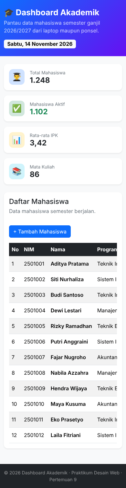
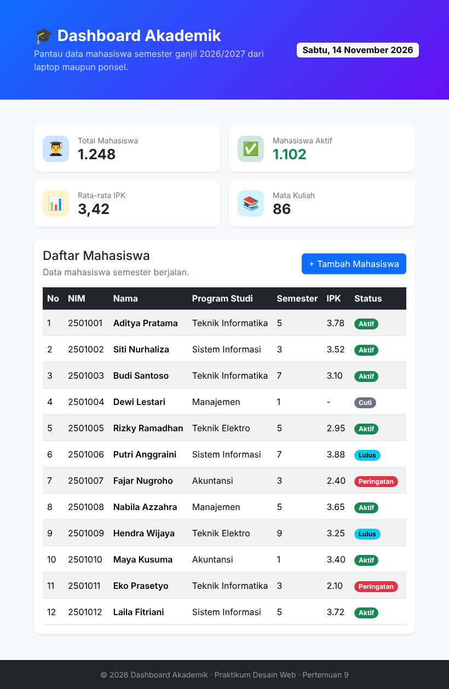
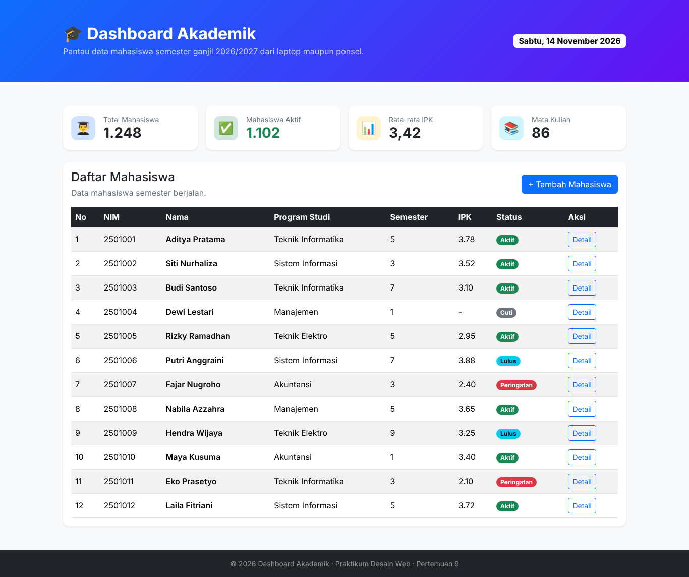

# Dashboard Akademik (Bootstrap 5)

Tugas Individu Praktikum Desain Web, Pertemuan 9: Grid System dan Table Responsif.

Halaman dashboard akademik dibuat dengan **Bootstrap 5.3.8** yang dipasang lewat **CDN**. Isinya header, 4 kartu statistik, tabel data mahasiswa (12 baris), dan footer.

## Struktur Folder

```
dashboard-akademik/
├── index.html
├── css/style.css
├── screenshots/
│   ├── hp-390px.png
│   ├── tablet-820px.png
│   └── laptop-1366px.png
└── README.md
```

Cara menjalankan: buka `index.html` di browser. Komputer harus terhubung internet karena Bootstrap dimuat dari CDN.

## Pemasangan Bootstrap (CDN)

| File | Letak | Alasan |
|---|---|---|
| CSS Bootstrap | di `<head>` | Tampilan harus siap sebelum halaman dirender |
| `css/style.css` (CSS sendiri) | di `<head>`, **setelah** Bootstrap | Supaya bisa menimpa tampilan bawaan |
| JS Bootstrap (`bootstrap.bundle.min.js`) | di bawah `<body>` | Tidak menghambat pemuatan konten halaman |

Versi dikunci di `5.3.8` (version pinning) agar tampilan tidak berubah kalau Bootstrap dirilis versi baru.

## Fungsi `container`, `row`, dan `col-*` pada Halaman Ini

Bootstrap menyusun tata letak dari tiga lapis yang bersarang: **container → row → column**.

| Lapisan | Class di halaman ini | Fungsi |
|---|---|---|
| **Container** | `<div class="container">` di header dan `<main class="container">` | Pembungkus yang membatasi lebar konten dan menaruhnya di tengah halaman. Tanpanya, konten melebar penuh sampai tepi layar. |
| **Row** | `<div class="row g-3">` | Mengelompokkan kolom secara horizontal dan mengatur jarak antar kolom (`g-3` = gutter). Row selalu menjadi anak container dan induk dari kolom. |
| **Column** | `col-12 col-md-6 col-lg-3` | Unit tata letak di dalam row. Lebarnya dihitung dari sistem 12 kolom dan berubah sesuai breakpoint. |

Contoh pada empat kartu statistik:

```html
<main class="container">                    <!-- 1. pembungkus -->
  <section class="row g-3">                 <!-- 2. baris -->
    <div class="col-12 col-md-6 col-lg-3">  <!-- 3. kolom (x4) -->
      <div class="card">...</div>
    </div>
  </section>
</main>
```

## Perubahan Layout pada Tiga Ukuran Layar

Setiap kartu memakai `col-12 col-md-6 col-lg-3`, sehingga jumlah kolomnya berubah mengikuti lebar layar:

| Layar | Lebar | Class aktif | Hasil | Perhitungan |
|---|---|---|---|---|
| HP | < 768px | `col-12` | **1 kolom**, kartu ditumpuk ke bawah | 12/12 |
| Tablet | ≥ 768px | `col-md-6` | **2 kolom**, tersusun 2 × 2 | 12/6 = 2 |
| Laptop | ≥ 992px | `col-lg-3` | **4 kolom** dalam satu baris | 12/3 = 4 |

> Catatan: pada Bootstrap 5.3 breakpoint `lg` adalah 992px. Di slide materi tertulis 1024px, tetapi nilai yang dipakai Bootstrap saat ini adalah 992px.

### Screenshot Hasil

**1. HP (390px): 1 kolom**

Kartu statistik ditumpuk ke bawah dengan lebar penuh (`col-12`). Tabel tidak muat, jadi bisa digeser ke samping lewat `table-responsive`.



**2. Tablet (820px): 2 kolom**

Mulai 768px class `col-md-6` aktif, sehingga kartu tersusun 2 × 2. Tombol "+ Tambah Mahasiswa" pindah sejajar di kanan judul (`text-md-end`).



**3. Laptop (1366px): 4 kolom**

Mulai 992px class `col-lg-3` aktif, sehingga keempat kartu berada dalam satu baris. Seluruh kolom tabel terlihat tanpa perlu digeser.



## Komponen yang Dipakai

**Tabel (3 class wajib)**

- `table-striped`: baris diberi warna selang-seling agar mudah dibaca.
- `table-hover`: baris menyala saat kursor berada di atasnya.
- `table-responsive`: tabel dibungkus `<div>` ini sehingga bisa digeser horizontal di layar kecil.

**Utility classes (lebih dari 3)**

- Warna: `bg-light`, `bg-dark`, `text-white`, `text-secondary`, `text-success`
- Jarak: `py-4`, `my-4`, `mb-4`, `mt-3`, `gap-3`
- Teks: `text-md-end`, `fw-bold`, `fw-semibold`, `small`
- Bayangan: `shadow-sm`
- Flex: `d-flex`, `align-items-center`

**Badge dan Button**

- Badge status: `text-bg-success` (Aktif), `text-bg-secondary` (Cuti), `text-bg-info` (Lulus), `text-bg-danger` (Peringatan).
- Button: `btn btn-primary` untuk "+ Tambah Mahasiswa" dan `btn btn-outline-primary btn-sm` untuk "Detail" di setiap baris.

## Masalah dan Solusi

| Masalah | Solusi |
|---|---|
| Tabel terpotong atau halaman ikut bergeser ke samping di HP karena kolomnya banyak | Tabel dibungkus `table-responsive`, jadi hanya tabelnya yang bisa digeser. |
| Teks di sel tabel turun baris sehingga baris menjadi tinggi dan tidak rapi | Di `style.css`, `white-space: nowrap` dipasang pada `th` dan `td`. Lebar berlebih ditangani oleh `table-responsive`. |
| Tinggi kartu statistik tidak sama di tablet dan laptop | Memakai `h-100` pada `card`, sehingga semua kartu dalam satu baris sama tinggi. |
| Tombol "+ Tambah Mahasiswa" menempel ke teks di HP | Diberi `mt-3 mt-md-0` agar ada jarak di HP dan sejajar di kanan pada tablet ke atas (`text-md-end`). |
| Kartu statistik perlu dibedakan dari tabel secara visual | Kartu diberi ikon berwarna (`*-subtle`) dan efek angkat saat hover lewat `css/style.css`. |
