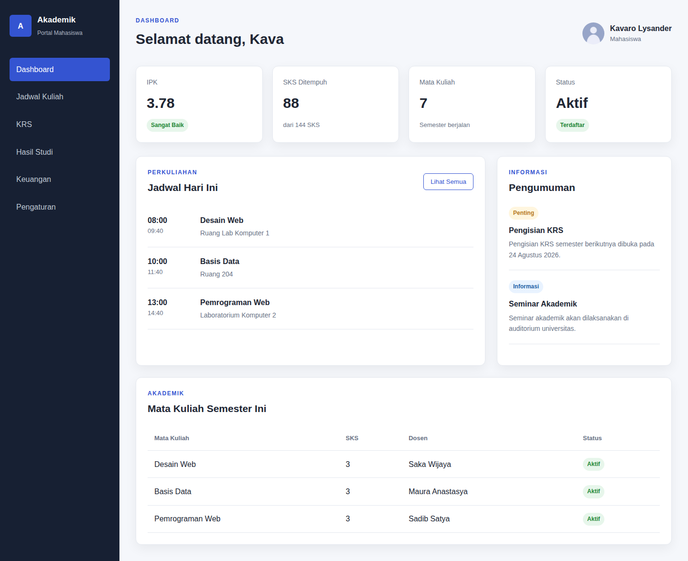
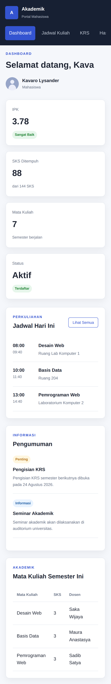
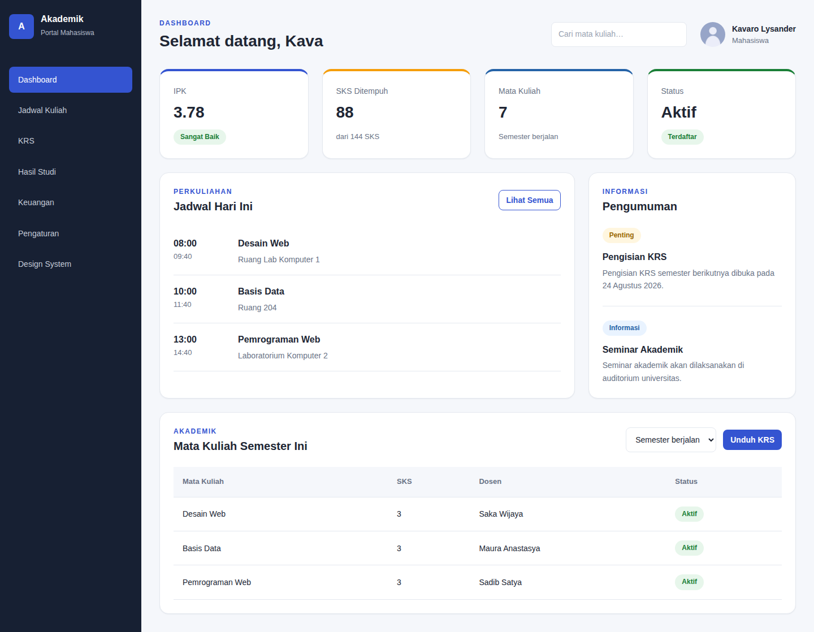
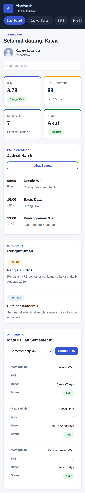
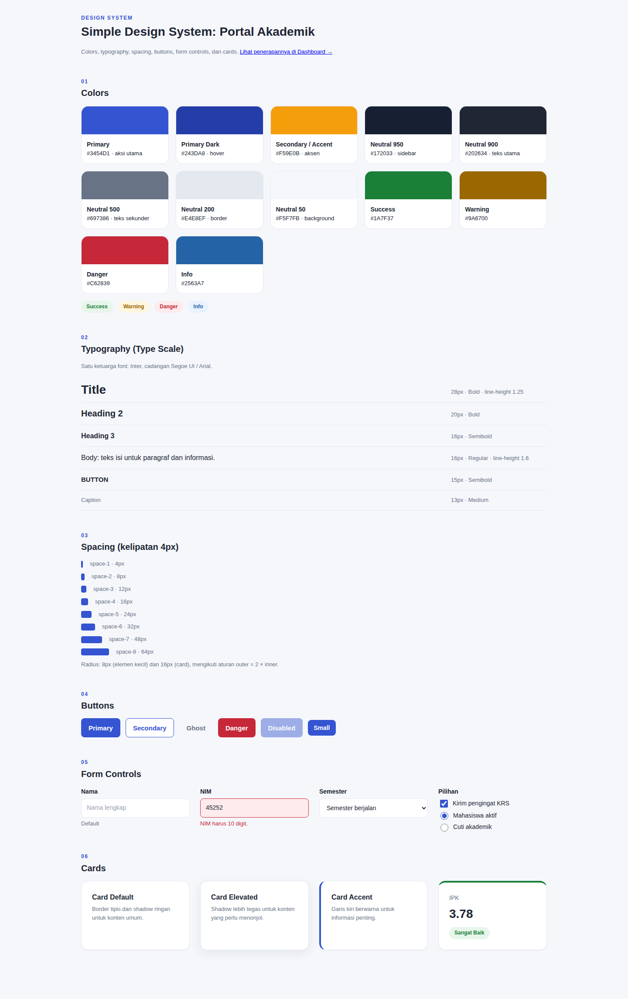
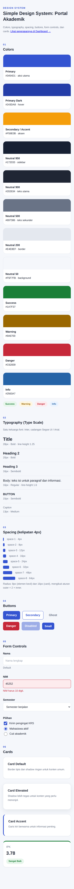

# Tugas Praktikum Pertemuan 6: Simple Design System dan Mockup Dashboard

- **Nama:** Khaira Rahma Aprilliani
- **Npm:** 4525210108
- **Mata Kuliah:** Praktikum Desain Web

Tugas: membuat *Simple Design System* (colors, typography, spacing, buttons, form controls, cards), lalu menerapkannya pada mockup Contoh 2 (Dashboard Mahasiswa) dengan color palette, type scale, button style, card style, dan tampilan mobile.

## Struktur Folder

```
Pertemuan6/
├── index.html            Dashboard (hasil penerapan design system)
├── design-system.html    Dokumentasi Simple Design System
├── css/style.css         Token + komponen + layout + responsive
├── images/Profile.jpe    Foto profil (file milikmu, taruh di sini)
├── screenshot/           Sebelum dan sesudah, desktop dan mobile
└── README.md
```

## Design System

| Bagian | Isi |
|--------|-----|
| Colors | Primary `#3454D1` (hover `#243DA8`), Secondary/Accent `#F59E0B`, Neutral (`#172033`, `#202634`, `#697386`, `#E4E8EF`, `#F5F7FB`), Status: Success `#1A7F37`, Warning `#9A6700`, Danger `#C62839`, Info `#2563A7` |
| Typography | Satu keluarga font (Inter, cadangan Segoe UI/Arial). Title 28/Bold, H2 20/Bold, H3 16/Semibold, Body 16/Regular, Button 15/Semibold, Caption 13/Medium |
| Spacing | Kelipatan 4px: 4, 8, 12, 16, 24, 32, 48, 64 (`--space-1` sampai `--space-8`) |
| Radius | 8px (elemen kecil) dan 16px (card), aturan outer = 2 × inner |
| Buttons | Primary, Secondary, Ghost, Danger, Disabled, ukuran Small |
| Form controls | Input, select, checkbox, radio, state error, dan teks bantuan |
| Cards | Default, Elevated, Accent (garis kiri), dan Stat Card |

Semua nilai disimpan sebagai CSS variables di `:root`, sehingga mengubah satu token langsung mengubah seluruh halaman.

## Dokumentasi Sebelum dan Sesudah

| | Desktop | Mobile |
|---|---------|--------|
| **Sebelum** |  |  |
| **Sesudah** |  |  |
| **Design System** |  |  |

## Perubahan, Masalah, dan Solusi

| No | Bagian | Masalah sebelumnya | Solusi |
|----|--------|--------------------|--------|
| 1 | Warna | Palet hanya biru dan status, tanpa aksen, dan semua stat card terlihat sama | Ditambah accent `#F59E0B`, skala neutral, status danger; stat card diberi garis atas berwarna berbeda |
| 2 | Tipografi | Ukuran font tersebar (12, 13, 14, 16, 17, 21, 30px) tanpa pola | Dibuat type scale: title, h2, h3, body, button, small, caption, eyebrow, dengan weight konsisten |
| 3 | Spacing | Nilai jarak acak (5px, 17px, 22px, 28px, 34px) | Semua jarak memakai token kelipatan 4px |
| 4 | Button | Hanya satu gaya (`btn-outline`), tanpa state fokus atau disabled | Dibuat `.btn` dengan varian primary, secondary, ghost, danger, ukuran kecil, state hover, fokus, disabled, dan tinggi minimal 44px untuk layar sentuh |
| 5 | Form | Belum ada form control | Ditambah komponen input, select, checkbox, radio, state error; dipakai pada kolom pencarian dan filter semester di dashboard |
| 6 | Card | Radius dan shadow dibuat terpisah di tiap komponen | Satu gaya `.card` dengan varian default, elevated, accent; radius 16px dan 8px konsisten |
| 7 | Tabel | Header tabel tidak berbeda dari isi; di mobile tabel harus digeser ke samping | Header diberi latar dan teks tebal, baris hover; di mobile tabel berubah menjadi kartu per mata kuliah (`data-label`) |
| 8 | Mobile | Sidebar hanya berubah menjadi menu horizontal polos, stat card menumpuk 1 kolom | Menu menjadi tab bulat yang menempel di atas (sticky), stat card 2 kolom, pencarian dan profil ditata ulang, tabel jadi kartu |
| 9 | Kode | `alt` foto profil bertuliskan nama lain ("Keonho") | Diperbaiki sesuai nama pemilik profil |

## Cara Menjalankan

1. Pastikan `index.html`, `design-system.html`, dan folder `css` dan `images` berada dalam satu folder.
2. Buka `index.html` di browser. Untuk melihat mobile, tekan `F12` lalu aktifkan *Toggle device toolbar*.
3. Halaman `design-system.html` bisa dibuka dari menu **Design System** di sidebar.

## Catatan

Screenshot dibuat dengan foto profil placeholder (lingkaran abu-abu) karena file asli `images/Profile.jpe` tidak ikut terunggah. Dengan file aslimu, foto akan tampil di posisi yang sama.
