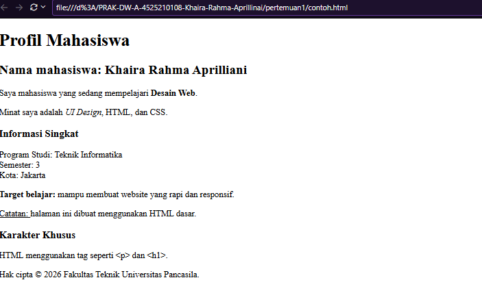

# Profil Mahasiswa - Khaira Rahma Aprilliani

Proyek web sederhana berbasis HTML dasar yang menampilkan informasi profil mahasiswa, program studi, serta catatan belajar Web Design.

---

## 📌 Deskripsi Proyek

Website statis ini dibuat menggunakan HTML dasar untuk menampilkan struktur informasi profil individu. Proyek ini memuat informasi umum mahasiswa, minat keahlian, program studi, serta demonstrasi penggunaan entitas karakter khusus (HTML entities).

---

## 👤 Informasi Mahasiswa

* **Nama:** Khaira Rahma Aprilliani
* **Program Studi:** Teknik Informatika
* **Semester:** 3
* **Kota:** Jakarta
* **Institusi:** Fakultas Teknik Universitas Pancasila

---

## 🛠️ Teknologi & Fitur yang Digunakan

* **HTML5:** Digunakan untuk menyusun struktur dokumen web.
* **Elemen Teks Sederhana:** Menggunakan heading (`<h1>`, `<h2>`, `<h3>`), paragraf (`
`), serta format teks (`<strong>`, `<em>`, `<b>`, `<u>`).
* **HTML Entities:** Penggunaan entitas karakter seperti `&lt;` (`<`), `&gt;` (`>`), dan `&copy;` (`©`).
* **Viewport Meta Tag:** Pengaturan responsivitas dasar agar tampilan menyesuaikan layar perangkat.

---

## 🚀 Cara Menjalankan Proyek

1. **Clone / Download** repositori ini ke komputer Anda.
2. Buka folder proyek.
3. Klik dua kali pada file `index.html` (atau file HTML terkait) untuk membukanya di peramban web (Chrome, Firefox, Edge, dsb.).

---

## 📄 Lisensi & Hak Cipta

© 2026 Fakultas Teknik Universitas Pancasila.

## Hasil Running
