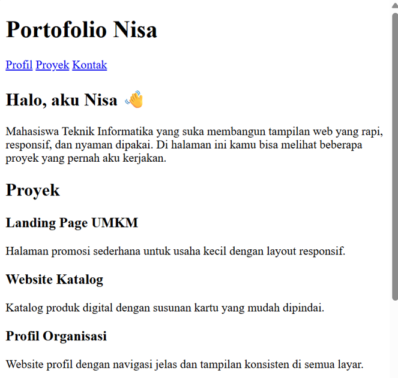
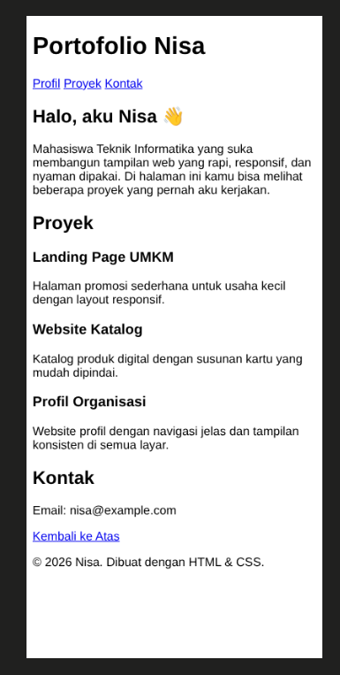
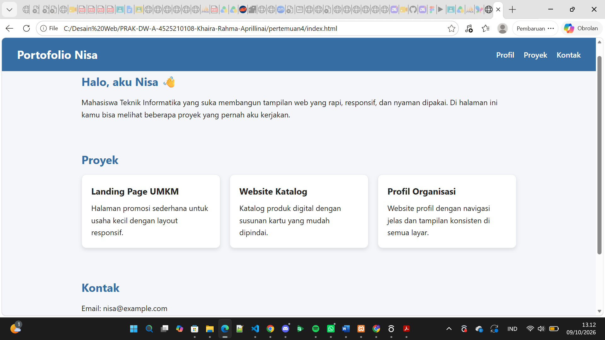
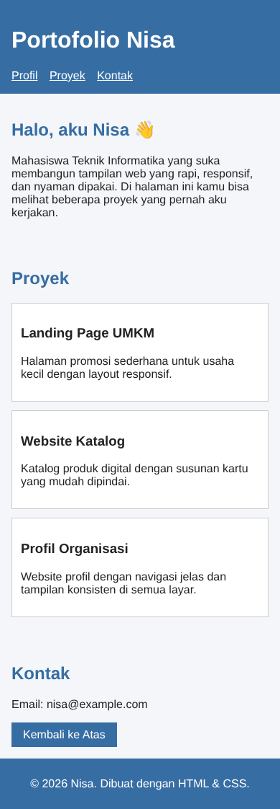

# Portofolio Nisa – Praktikum CSS Lanjutan (Pertemuan 4)

Tugas individu: membangun ulang halaman profil menjadi 2 file (`index.html` dan `style.css`) dengan memanfaatkan box model, class reusable, dan media query.

`index.html` memanggil CSS lewat `<link rel="stylesheet" href="css/style.css">`.

## Cara Menjalankan

1. Buka folder `pertemuan4` di VS Code.
2. Buka `index.html` di browser (klik dua kali, atau pakai Live Server / Simple Browser).
3. Ubah lebar jendela di bawah 768px (atau pakai mode responsive di DevTools) untuk melihat tampilan mobile.

## Penjelasan Perubahan

### 1. Header & Navigasi
- Header dibuat sticky dengan `position: sticky; top: 0; z-index: 1000;` supaya tetap menempel di atas saat halaman digulir.
- Header memakai Flexbox (`display: flex; justify-content: space-between;`) sehingga judul `<h1>` ada di kiri dan `<nav>` di kanan.

### 2. Kartu Proyek (`.card`)
- Latar belakang putih `#ffffff`.
- Bayangan lembut: `box-shadow: 0 4px 8px rgba(0, 0, 0, 0.1);`.
- Efek hover: `transform: translateY(-5px);` dengan `transition` agar geraknya halus.

### 3. Tombol "Kembali ke Atas" (`.button`)
- Sudut lengkung penuh (pill) dengan `border-radius: 25px;`.
- Saat hover, latar berubah menjadi hijau tua `#2e7d32` dan teks tetap putih.

### 4. Footer
- Latar `#366da3` (senada dengan header), ukuran teks `14px`.
- Garis pembatas atas `border-top: 2px solid #ffffff33;` dan `padding: 20px;`.

## Syarat Tugas yang Dipenuhi

| Syarat | Implementasi |
|---|---|
| 2 file (HTML + CSS) | `index.html` dan `css/style.css` |
| Box model | `box-sizing: border-box` global; `padding`, `border`, dan `margin` dipakai di `.container`, `.card`, dan `.button` |
| Minimal 2 class reusable | `.container`, `.card`, `.button` |
| 1 media query di bawah 768px | `@media (max-width: 767px)` |

## Masalah dan Solusi

| Masalah | Solusi |
|---|---|
| Tampilan halaman polos (CSS tidak terbaca) | Path CSS di `index.html` salah (`style.css`), padahal file ada di folder `css/`. Diperbaiki menjadi `css/style.css`. |
| 3 card tidak nyaman dibaca di layar kecil | Card disusun dengan CSS Grid 3 kolom, lalu pada media query di bawah 768px diubah menjadi 1 kolom (`grid-template-columns: 1fr`). |
| Ukuran elemen melebihi lebar yang diatur karena padding dan border | Memakai `box-sizing: border-box` pada semua elemen agar `width` sudah mencakup padding dan border. |
| Header terlalu sempit di layar kecil | Pada media query, header diubah menjadi `flex-direction: column` sehingga judul dan menu tersusun ke bawah. |

## Screenshot

Sebelum perubahan:

- Desktop: 
- Mobile: 

Sesudah perubahan:

- Desktop: 
- Mobile: !
