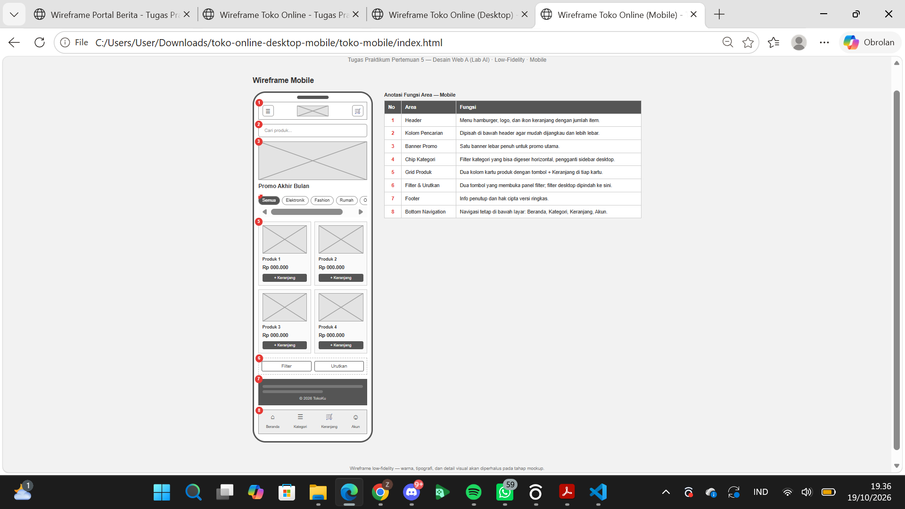
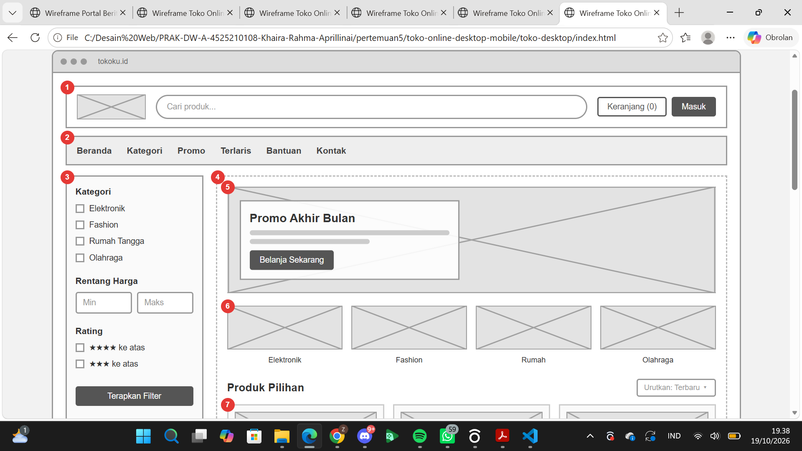

# Wireframe Toko Online (TokoKu)

Tugas Praktikum Pertemuan 5 — Desain Web A (Lab AI)
Topik: Design Kerangka Website — Wireframe dan Struktur Informasi

| | |
|---|---|
| Nama | Khaira Rahma Aprilliani |
| NPM | 4525210108 |
| Kelas | Desain Web A |


## Deskripsi

Wireframe low-fidelity untuk website **toko online** bernama *TokoKu*. Wireframe dibuat dalam dua versi, yaitu **desktop** dan **mobile**, lengkap dengan anotasi fungsi setiap area. Sesuai tahap low-fi, gambar hanya berupa placeholder abu-abu, sedangkan warna dan tipografi akan diperhalus pada tahap mockup.

Studi kasus: klien sering mengubah susunan konten sebelum coding, jadi struktur halaman disepakati lebih dulu lewat wireframe dengan biaya rendah.

## Struktur Folder

```
.
├── README.md
├── toko-desktop/
│   ├── index.html
│   ├── style.css
│   └── images/
│       └── placeholder.svg
└── toko-mobile/
    ├── index.html
    ├── style.css
    └── images/
        └── placeholder.svg
```

Kedua folder berdiri sendiri, jadi bisa dibuka dan dikumpulkan terpisah.


## Struktur Layout

### Desktop

Menggunakan sidebar filter karena toko online butuh penyaringan produk.

| No | Area | Fungsi |
|----|------|--------|
| 1 | Header | Logo, pencarian produk, keranjang, dan login |
| 2 | Navbar | Navigasi utama (Beranda, Kategori, Promo, Terlaris, Bantuan, Kontak) |
| 3 | Sidebar Filter | Filter kategori, rentang harga, dan rating |
| 4 | Content | Area utama etalase produk |
| 5 | Banner Promo | Promo utama dengan tombol ajakan belanja |
| 6 | Kategori Populer | Jalan pintas visual ke kategori |
| 7 | Grid Produk | Kartu produk: gambar, nama, harga, rating |
| 8 | Tombol + Keranjang | CTA utama menambah produk |
| 9 | Pagination | Pindah halaman daftar produk |
| 10 | Footer | Info toko, bantuan, pembayaran/pengiriman, hak cipta |

### Mobile

Sidebar diganti tombol Filter/Urutkan dan navigasi dipindah ke bawah agar mudah dijangkau jempol.

| No | Area | Fungsi |
|----|------|--------|
| 1 | Header | Menu hamburger, logo, ikon keranjang |
| 2 | Kolom Pencarian | Dipisah di bawah header agar lebih lebar |
| 3 | Banner Promo | Satu banner lebar penuh |
| 4 | Chip Kategori | Filter kategori yang bisa digeser horizontal |
| 5 | Grid Produk | Dua kolom kartu produk dengan tombol + Keranjang |
| 6 | Filter & Urutkan | Membuka panel filter |
| 7 | Footer | Info penutup versi ringkas |
| 8 | Bottom Navigation | Beranda, Kategori, Keranjang, Akun |

## Screenshoot Hasil

### Mobile


### Desktop



## Perbedaan Desktop vs Mobile

- Sidebar filter di desktop menjadi tombol Filter/Urutkan dan chip kategori di mobile.
- Navbar horizontal di desktop menjadi menu hamburger dan bottom navigation di mobile.
- Grid produk 3 kolom di desktop menjadi 2 kolom di mobile.
- Tombol CTA dibuat lebar penuh di mobile agar mudah ditekan.

## Teknologi

- HTML5 semantik (`header`, `nav`, `main`, `aside`, `section`, `article`, `footer`)
- CSS3 (Flexbox dan CSS Grid)
- Tanpa framework dan tanpa JavaScript

## Catatan

Wireframe ini bersifat low-fidelity. Tampilan akhir (warna, tipografi, gambar asli) dikerjakan pada tahap mockup dan high-fidelity.