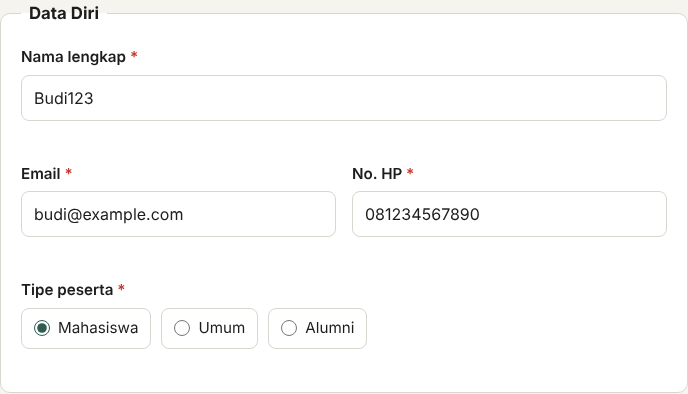
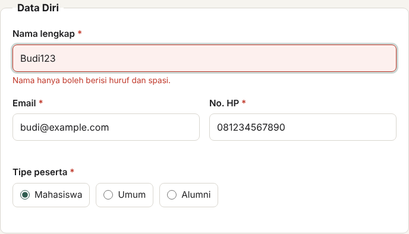
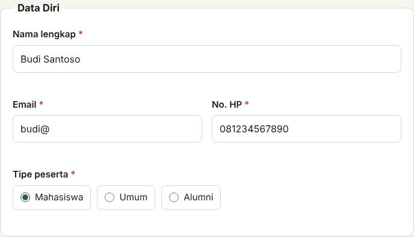
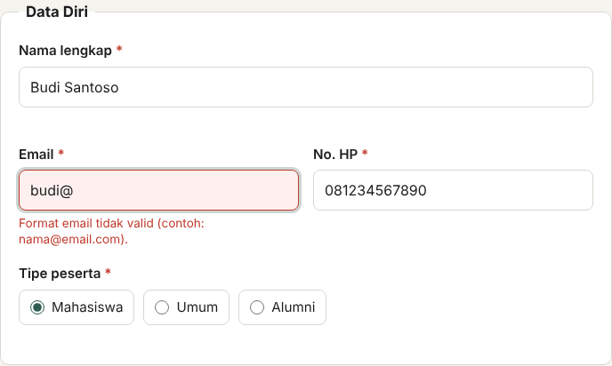
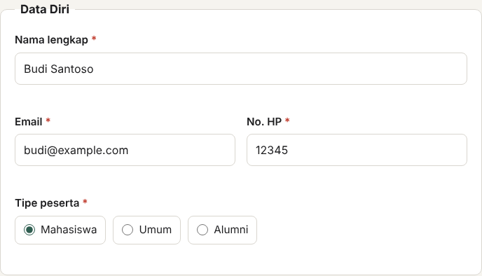
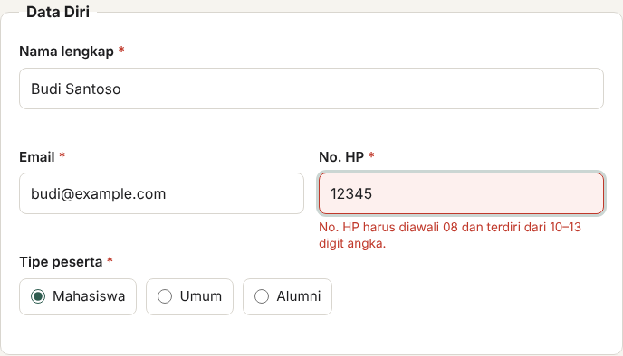
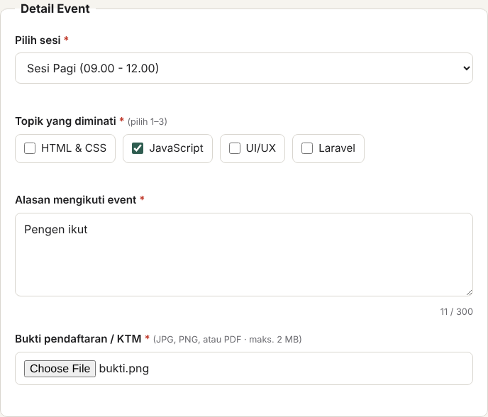
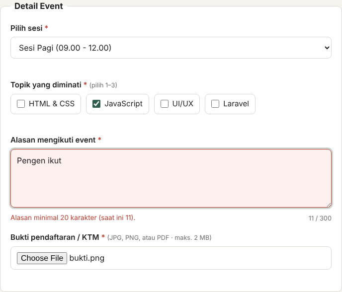
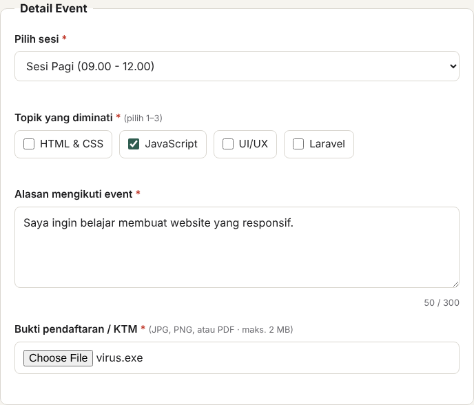
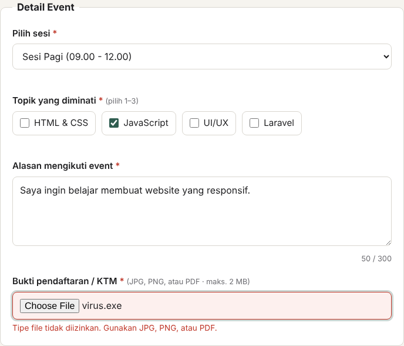

# Form Registrasi Event — Validasi Form

Tugas Praktikum Pertemuan 7 (Tugas Individu) — Desain Web A (Lab AI)

| | |
|---|---|
| Nama | [Khaira Rahma Aprilliani |
| NPM | 4525210108 |
| Kelas | Desain Web A |

## Deskripsi

Form registrasi untuk event *Web Development Workshop* dengan validasi di sisi client (HTML + JavaScript murni, tanpa framework). Form memakai elemen **radio, checkbox, select, textarea, dan upload file**, dengan **9 aturan validasi** (syarat minimal 4).

## Struktur Folder

```
form-event/
├── index.html
├── style.css
├── script.js
├── README.md
└── screenshots/
    ├── TC-01-nama/        (desktop & mobile, sebelum & sesudah)
    ├── TC-02-email/
    ├── TC-03-no-hp/
    ├── TC-04-alasan/
    ├── TC-05-upload/
    ├── TC-06-upload-ukuran/
    ├── TC-07-checkbox-topik/
    ├── TC-08-select-sesi/
    ├── TC-09-persetujuan/
    ├── TC-10-input-benar/
    └── ringkasan/
```

Cara menjalankan: buka `index.html` di browser. Tidak perlu install apa pun.

## Elemen Form

| Elemen | Field | Keterangan |
|---|---|---|
| Text | Nama lengkap | Wajib, min. 3 karakter, hanya huruf |
| Email | Email | Wajib, format email |
| Tel | No. HP | Wajib, diawali 08, 10–13 digit |
| **Radio** | Tipe peserta | Mahasiswa / Umum / Alumni |
| **Select** | Pilih sesi | Sesi Pagi / Sesi Siang |
| **Checkbox** | Topik diminati | Pilih 1–3 topik |
| **Textarea** | Alasan mengikuti | 20–300 karakter + penghitung karakter |
| **Upload** | Bukti pendaftaran / KTM | JPG, PNG, PDF, maks. 2 MB |
| **Checkbox** | Persetujuan | Wajib dicentang |

## Aturan Validasi

| No | Aturan | Field |
|---|---|---|
| 1 | Wajib diisi (required) | Semua field |
| 2 | Format email | Email |
| 3 | Pola nomor HP (regex) | No. HP |
| 4 | Hanya huruf (regex) + panjang minimal | Nama |
| 5 | Panjang minimal dan maksimal | Alasan |
| 6 | Jumlah pilihan minimal 1 dan maksimal 3 | Topik |
| 7 | Tipe file yang diizinkan | Bukti |
| 8 | Ukuran file maksimal 2 MB | Bukti |
| 9 | Harus dicentang | Persetujuan |

Pesan error tampil per field (di bawah input, warna merah) saat field ditinggalkan dan saat tombol Daftar ditekan. Saat submit gagal, muncul ringkasan jumlah error dan fokus pindah ke field pertama yang salah.

## Test Case Validasi

Setiap test case dijalankan otomatis di browser (Chromium) dengan data lain tetap valid, hanya satu field yang diubah. Hasil aktual diambil langsung dari pesan yang tampil di halaman. Ada 9 skenario input salah (syarat minimal 5) dan 1 kontrol input benar.

| ID | Field | Input uji | Hasil yang diharapkan | Hasil aktual | Status | Screenshot (D = desktop, M = mobile) |
|---|---|---|---|---|---|---|
| TC-01 | nama | Budi123 (mengandung angka) | Nama hanya boleh berisi huruf dan spasi. | Nama hanya boleh berisi huruf dan spasi. | PASS | [D-sebelum](screenshots/TC-01-nama/desktop-sebelum.png) [D-sesudah](screenshots/TC-01-nama/desktop-sesudah.png)<br>[M-sebelum](screenshots/TC-01-nama/mobile-sebelum.png) [M-sesudah](screenshots/TC-01-nama/mobile-sesudah.png) |
| TC-02 | email | budi@ (tanpa domain) | Format email tidak valid (contoh: nama@email.com). | Format email tidak valid (contoh: nama@email.com). | PASS | [D-sebelum](screenshots/TC-02-email/desktop-sebelum.png) [D-sesudah](screenshots/TC-02-email/desktop-sesudah.png)<br>[M-sebelum](screenshots/TC-02-email/mobile-sebelum.png) [M-sesudah](screenshots/TC-02-email/mobile-sesudah.png) |
| TC-03 | hp | 12345 (tidak diawali 08, terlalu pendek) | No. HP harus diawali 08 dan terdiri dari 10–13 digit angka. | No. HP harus diawali 08 dan terdiri dari 10–13 digit angka. | PASS | [D-sebelum](screenshots/TC-03-no-hp/desktop-sebelum.png) [D-sesudah](screenshots/TC-03-no-hp/desktop-sesudah.png)<br>[M-sebelum](screenshots/TC-03-no-hp/mobile-sebelum.png) [M-sesudah](screenshots/TC-03-no-hp/mobile-sesudah.png) |
| TC-04 | alasan | "Pengen ikut" (11 karakter) | Alasan minimal 20 karakter (saat ini 11). | Alasan minimal 20 karakter (saat ini 11). | PASS | [D-sebelum](screenshots/TC-04-alasan/desktop-sebelum.png) [D-sesudah](screenshots/TC-04-alasan/desktop-sesudah.png)<br>[M-sebelum](screenshots/TC-04-alasan/mobile-sebelum.png) [M-sesudah](screenshots/TC-04-alasan/mobile-sesudah.png) |
| TC-05 | bukti | virus.exe (tipe tidak diizinkan) | Tipe file tidak diizinkan. Gunakan JPG, PNG, atau PDF. | Tipe file tidak diizinkan. Gunakan JPG, PNG, atau PDF. | PASS | [D-sebelum](screenshots/TC-05-upload/desktop-sebelum.png) [D-sesudah](screenshots/TC-05-upload/desktop-sesudah.png)<br>[M-sebelum](screenshots/TC-05-upload/mobile-sebelum.png) [M-sesudah](screenshots/TC-05-upload/mobile-sesudah.png) |
| TC-06 | bukti | foto.png berukuran 3 MB | Ukuran file melebihi 2 MB. | Ukuran file melebihi 2 MB. | PASS | [D-sebelum](screenshots/TC-06-upload-ukuran/desktop-sebelum.png) [D-sesudah](screenshots/TC-06-upload-ukuran/desktop-sesudah.png)<br>[M-sebelum](screenshots/TC-06-upload-ukuran/mobile-sebelum.png) [M-sesudah](screenshots/TC-06-upload-ukuran/mobile-sesudah.png) |
| TC-07 | topik | Tidak ada topik dicentang | Pilih minimal 1 topik. | Pilih minimal 1 topik. | PASS | [D-sebelum](screenshots/TC-07-checkbox-topik/desktop-sebelum.png) [D-sesudah](screenshots/TC-07-checkbox-topik/desktop-sesudah.png)<br>[M-sebelum](screenshots/TC-07-checkbox-topik/mobile-sebelum.png) [M-sesudah](screenshots/TC-07-checkbox-topik/mobile-sesudah.png) |
| TC-08 | sesi | Sesi tidak dipilih ("-- Pilih sesi --") | Silakan pilih sesi event. | Silakan pilih sesi event. | PASS | [D-sebelum](screenshots/TC-08-select-sesi/desktop-sebelum.png) [D-sesudah](screenshots/TC-08-select-sesi/desktop-sesudah.png)<br>[M-sebelum](screenshots/TC-08-select-sesi/mobile-sebelum.png) [M-sesudah](screenshots/TC-08-select-sesi/mobile-sesudah.png) |
| TC-09 | setuju | Checkbox persetujuan tidak dicentang | Kamu harus menyetujui syarat & ketentuan. | Kamu harus menyetujui syarat & ketentuan. | PASS | [D-sebelum](screenshots/TC-09-persetujuan/desktop-sebelum.png) [D-sesudah](screenshots/TC-09-persetujuan/desktop-sesudah.png)<br>[M-sebelum](screenshots/TC-09-persetujuan/mobile-sebelum.png) [M-sesudah](screenshots/TC-09-persetujuan/mobile-sesudah.png) |
| TC-10 | semua | Semua data valid (kontrol) | (tidak ada error) → pesan sukses tampil | Pesan sukses tampil | PASS | [D-sebelum](screenshots/TC-10-input-benar/desktop-sebelum.png) [D-sesudah](screenshots/TC-10-input-benar/desktop-sesudah.png)<br>[M-sebelum](screenshots/TC-10-input-benar/mobile-sebelum.png) [M-sesudah](screenshots/TC-10-input-benar/mobile-sesudah.png) |

## Screenshot Sebelum dan Sesudah

Setiap test case punya 4 screenshot di `screenshots/TC-xx-.../`: **sebelum** (input salah sudah diisi, tombol Daftar belum ditekan) dan **sesudah** (tombol Daftar ditekan, pesan error tampil), masing-masing untuk desktop (1280 px) dan mobile (390 px). TC-10 adalah kontrol input benar, jadi sesudahnya menampilkan pesan sukses.

Lima skenario utama (desktop):

**TC-01 — Budi123 (mengandung angka)**

| Sebelum | Sesudah |
|---|---|
|  |  |

**TC-02 — budi@ (tanpa domain)**

| Sebelum | Sesudah |
|---|---|
|  |  |

**TC-03 — 12345 (tidak diawali 08, terlalu pendek)**

| Sebelum | Sesudah |
|---|---|
|  |  |

**TC-04 — "Pengen ikut" (11 karakter)**

| Sebelum | Sesudah |
|---|---|
|  |  |

**TC-05 — virus.exe (tipe tidak diizinkan)**

| Sebelum | Sesudah |
|---|---|
|  |  |

Versi mobile semua skenario ada di folder yang sama (`mobile-sebelum.png` dan `mobile-sesudah.png`).

Tampilan seluruh halaman saat semua input salah sekaligus ada di `screenshots/ringkasan/`:

- `screenshot-desktop-input-salah.png`
- `screenshot-mobile-input-salah.png`
- `screenshot-desktop-input-benar.png`

## Validasi yang Tetap Wajib di Server

Validasi di JavaScript hanya untuk kenyamanan pengguna (feedback cepat). Pengguna bisa melewatinya dengan mematikan JavaScript, mengubah HTML lewat DevTools, atau mengirim request langsung (curl/Postman). Jadi **semua aturan di atas harus diulang di server**, dan beberapa hal hanya bisa dilakukan di server:

1. **Semua aturan required, format, dan panjang**: ulangi persis seperti di client, karena data dari client tidak boleh dipercaya.
2. **Tipe file yang sebenarnya**: client hanya mengecek ekstensi nama file, yang mudah dipalsukan (`virus.exe` diganti nama jadi `virus.png`). Server harus memeriksa MIME type asli / magic bytes, lalu menyimpan dengan nama file baru yang dibuat server.
3. **Ukuran file**: batasi juga di konfigurasi server (`upload_max_filesize`, `post_max_size`), bukan hanya di JavaScript.
4. **Nilai radio, select, dan checkbox**: cek bahwa nilainya ada dalam daftar yang diizinkan (whitelist). Request manual bisa mengirim `sesi=hacker`.
5. **Keunikan data**: hanya server yang bisa mengecek apakah email sudah terdaftar atau kuota sesi masih tersisa.
6. **Keamanan penyimpanan dan output**: query memakai prepared statement (cegah SQL injection), output di-escape (cegah XSS), dan form dilindungi token CSRF.

Contoh di Laravel:

```php
$request->validate([
    'nama'   => ['required', 'string', 'min:3', 'regex:/^[A-Za-z .\'-]+$/'],
    'email'  => ['required', 'email', 'unique:peserta,email'],
    'hp'     => ['required', 'regex:/^08\d{8,11}$/'],
    'tipe'   => ['required', 'in:mahasiswa,umum,alumni'],
    'sesi'   => ['required', 'in:pagi,siang'],
    'topik'  => ['required', 'array', 'min:1', 'max:3'],
    'alasan' => ['required', 'string', 'min:20', 'max:300'],
    'bukti'  => ['required', 'file', 'mimes:jpg,jpeg,png,pdf', 'max:2048'],
    'setuju' => ['accepted'],
]);
```

## Perubahan, Masalah, dan Solusi

**Perubahan yang dibuat**
- Form memakai atribut `novalidate` sehingga validasi dikontrol sepenuhnya oleh `script.js`, dengan pesan error berbahasa Indonesia yang konsisten di semua browser.
- Validasi berjalan per field saat pengguna selesai mengisi, lalu seluruh form dicek ulang saat submit.
- Atribut `aria-invalid` dan `role="alert"` ditambahkan agar error bisa dibaca screen reader.

**Masalah 1: layout bergeser dan klik pertama pada radio/checkbox hilang.**
Saat pengguna mengisi No. HP dengan nilai salah lalu langsung mengklik radio, field HP kehilangan fokus dan pesan error muncul. Pesan itu mendorong radio ke bawah sekitar 28 px di antara mousedown dan mouseup, sehingga klik tidak tercatat. Masalah ini ketahuan saat tes otomatis gagal mencentang radio.
*Solusi:* ruang untuk pesan error disisakan tetap (`min-height` pada `.error`), jadi posisi elemen tidak berubah saat error muncul atau hilang. Setelah diperbaiki, semua test case lolos.

**Masalah 2: checkbox group tidak bisa divalidasi dengan atribut `required` bawaan HTML.**
`required` pada checkbox hanya berlaku per kotak, sedangkan aturannya "minimal 1 dan maksimal 3".
*Solusi:* validasi custom di JavaScript yang menghitung jumlah checkbox terpilih.

**Masalah 3: pengecekan tipe file hanya lewat ekstensi mudah dipalsukan.**
*Solusi:* di client tetap dicek ekstensi dan ukuran untuk feedback cepat, dan pengecekan MIME type asli diwajibkan di server (lihat bagian di atas).

**Masalah 4: pengguna mobile tidak melihat error yang ada di bawah layar.**
*Solusi:* saat submit gagal, fokus dan scroll otomatis pindah ke field pertama yang salah, ditambah ringkasan jumlah error di atas tombol Daftar.

## Catatan

Form ini belum terhubung ke server. Saat semua validasi lolos, form menampilkan pesan sukses sebagai simulasi.
